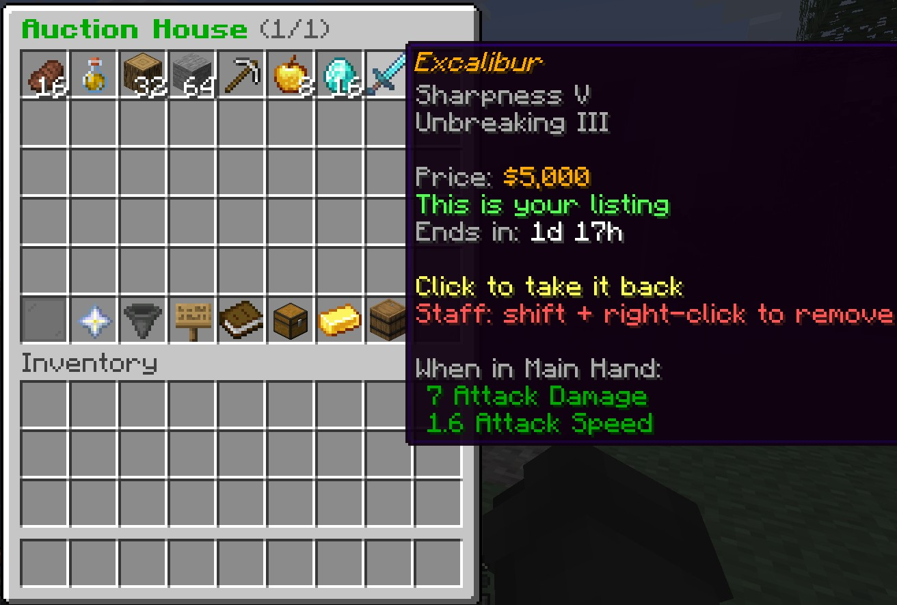
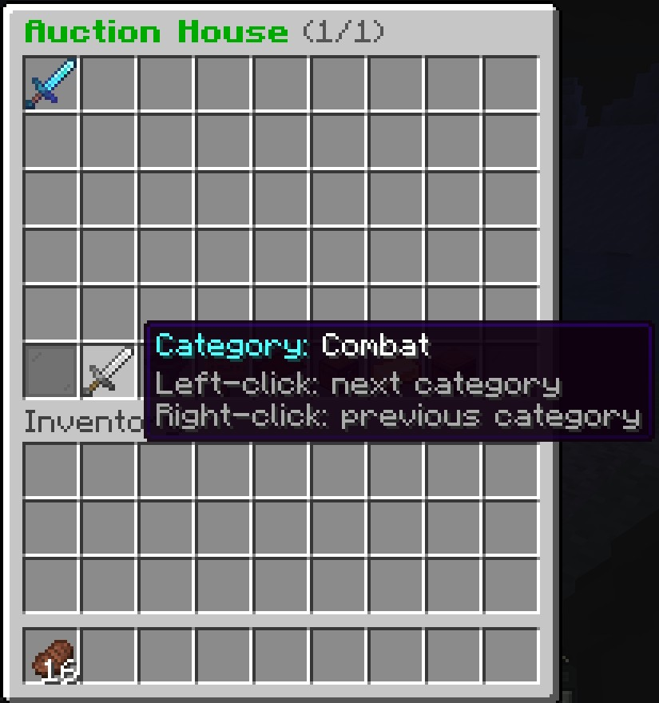
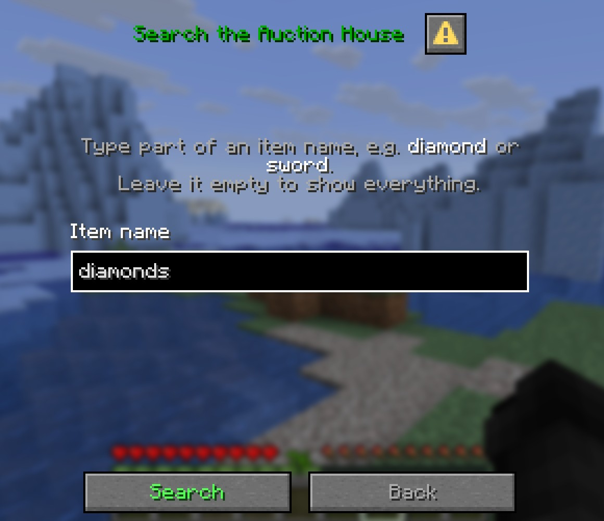
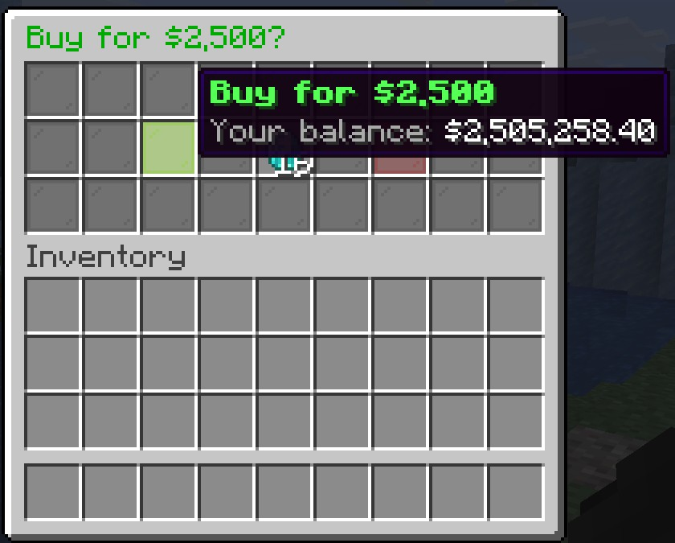
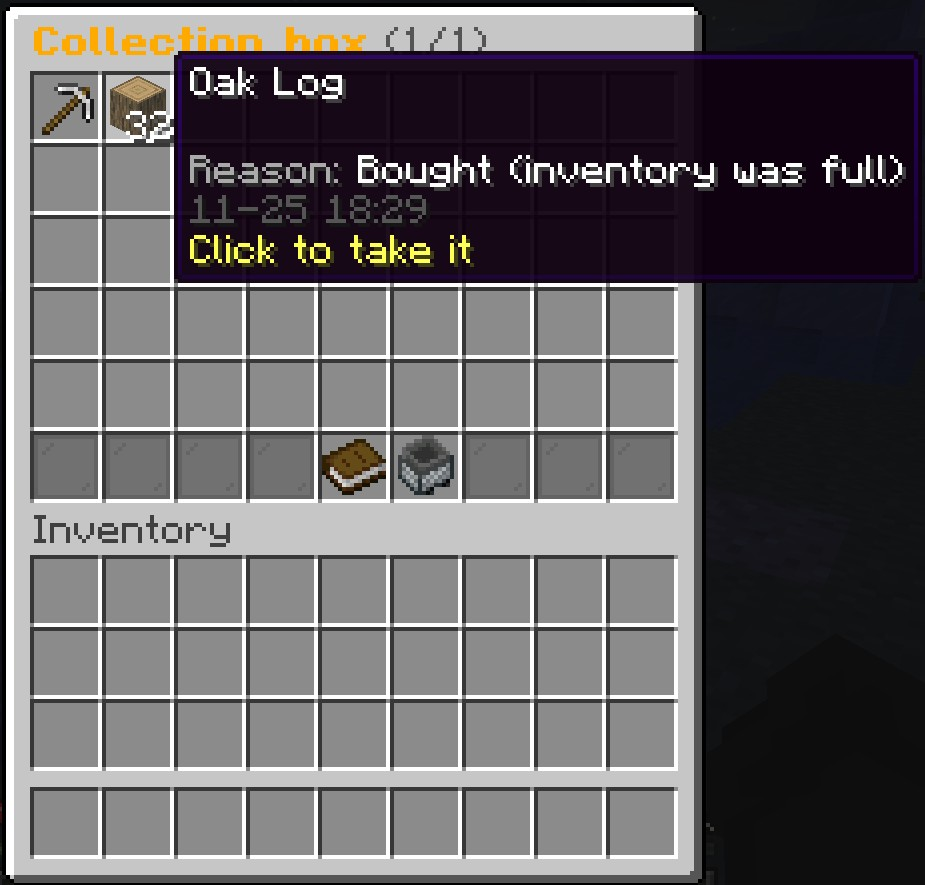
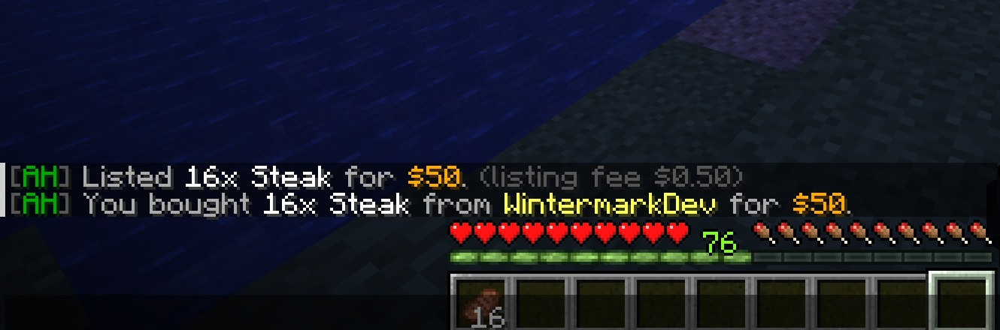

# Wintermark Auctions

**An auction house for Paper servers: list the item in your hand, browse by category, search, buy with one confirm click.**
Expiry with a collection box, sales tax and listing fees, VIP listing limits and offline sale summaries, all safe against item and money dupes.



## Features

- **Sell in one command.** Hold an item and type `/ah sell 2.5k`. Enchantments, custom names and every other item detail are kept exactly.
- **Clean menu.** 45 listings per page with price, seller and time left, plus a bottom bar: pages, category, sort, search, my listings, your balance and the collection box.
- **Categories.** All, Blocks, Tools, Combat, Food, Potions & Books and Misc, sorted automatically. Left-click the button for the next one, right-click for the previous one.
- **Search.** Type part of an item name in Minecraft's native text-input screen, or use `/ah search <text>`.
- **Sorting.** Newest, cheapest or most expensive first. Filters and page are kept when you go to a confirm screen and back.
- **Buy confirmation.** Every purchase shows a confirm screen with the price and your balance.
- **Collection box.** Expired listings, items you took back, items staff removed and purchases that didn't fit in your inventory wait in `/ah collect`. Take them one by one or all at once. Players get a reminder when they join.
- **Offline sales.** Sellers are paid instantly. If they were offline, they get a summary of what sold when they join.
- **Money sinks and limits.** Listing fee, sales tax, minimum and maximum price, max listings per player with VIP limits through permissions (`wintermark.ah.limit.10`).
- **Staff tools.** Shift + right-click any listing to remove it; the item goes back to the seller's collection box.
- **Dupe-safe.** The item leaves your inventory before the listing exists, and a listing is removed before any money moves, so nothing can be sold twice.
- **Works with any economy.** Uses [Wintermark Economy](https://github.com/wintermarkinteractive/WintermarkEconomy) directly, or any Vault economy (EssentialsX, CMI...).
- **Fully configurable.** Prices, fees, limits, blocked items, every menu text and message (MiniMessage colors). New settings are added to your config automatically on updates.

| Categories | Search |
|---|---|
|  |  |

| Confirm a purchase | Collection box |
|---|---|
|  |  |



## The Wintermark Economy Suite

Three plugins built to work together, each one usable on its own:

| Plugin | What it does |
|---|---|
| [Wintermark Economy](https://github.com/wintermarkinteractive/WintermarkEconomy) | The money: balances, payments, banknotes, history |
| [Wintermark Bounties](https://github.com/wintermarkinteractive/WintermarkBounties) | Put money on other players' heads, claim it with a kill |
| **Wintermark Auctions** | Auction house with categories, search and a collection box |

With Wintermark Economy installed, every sale shows up in `/money history` as AUCTION with the item name.

## Requirements

- **Paper 26.3** (or a Paper fork such as Purpur) with **Java 25**
- An economy: [Wintermark Economy](https://github.com/wintermarkinteractive/WintermarkEconomy) (recommended), or [VaultUnlocked](https://modrinth.com/plugin/vaultunlocked)/Vault + any economy plugin
- Not tested on Folia or Spigot

## Installation

1. Install an economy (see above).
2. Download `WintermarkAuctions-1.0.0.jar` and put it in your server's `plugins` folder.
3. Start the server. `plugins/WintermarkAuctions/config.yml` and `auctions.db` are created.
4. Check the console: it says which economy was found. Without one, the plugin turns itself off.

## Commands

Main command `/ah`, aliases `/auction` and `/auctionhouse`.

| Command | Description | Permission |
|---|---|---|
| `/ah` | Open the auction house | `wintermark.ah.use` |
| `/ah sell <price>` | List the item in your hand (`500`, `2.5k`, `1m`) | `wintermark.ah.sell` |
| `/ah search [text]` | Search by item name (no text = open the search screen) | `wintermark.ah.use` |
| `/ah my` | Your own listings; click one to take it back | `wintermark.ah.use` |
| `/ah collect` | Your collection box (alias `/ah box`) | `wintermark.ah.use` |
| `/ah reload` | Reload `config.yml` | `wintermark.ah.admin` |

**Permissions**

| Permission | Default | Description |
|---|---|---|
| `wintermark.ah.use` | everyone | Open the menu, search, my listings, collection box |
| `wintermark.ah.sell` | everyone | List items |
| `wintermark.ah.buy` | everyone | Buy items |
| `wintermark.ah.limit.<n>` | - | Raise the listing limit to `<n>` (the highest one counts), e.g. for VIP ranks |
| `wintermark.ah.admin` | op | Reload, and remove any listing with shift + right-click |

## Configuration

The default config is commented line by line. The main sections:

```yaml
listing-hours: 48              # then the item goes to the seller's collection box
listing-fee-percent: 1         # paid when listing, not refunded
sales-tax-percent: 5           # taken from the seller's payout
max-listings: 5                # per player; 0 = no limit; VIP: wintermark.ah.limit.<n>
min-price: "1"
max-price: "0"                 # "0" = no maximum
broadcast-new-listings: false
blocked-items: [BEDROCK, BARRIER, COMMAND_BLOCK]

menu:                          # titles, listing lore, bottom bar buttons
categories:                    # category names
sorts:                         # sort names
search-dialog:                 # the search input screen
collect:                       # collection box texts and reasons
confirm-buy:                   # confirm screens
confirm-cancel:
messages:                      # every message
```

Text uses [MiniMessage](https://docs.advntr.dev/minimessage/format.html). Set any message to `""` to turn it off.

## FAQ

**What happens when a listing expires?**
The item goes to the seller's collection box (`/ah collect`, or the barrel button in the menu). Nothing is ever dropped on the ground or lost.

**What if the buyer's inventory is full?**
The purchase still goes through and the item waits in the buyer's collection box.

**How do I give VIPs more listings?**
Give their rank the permission `wintermark.ah.limit.10` (any number). The highest limit a player has counts.

**Can I test buying on a server with only me?**
Set `allow-buy-own: true` and `/ah reload`. Turn it off again before players join.

**Where is data stored?**
`plugins/WintermarkAuctions/auctions.db` (SQLite): listings, sale records, collection boxes and offline sale summaries.

## Building from source

```
git clone https://github.com/wintermarkinteractive/WintermarkAuctions.git
cd WintermarkAuctions
./gradlew build
```

The jar is in `build/libs/`. Requires JDK 25. Put the VaultUnlocked jar in `libs/` first (see `libs/README.md`); the jars there are only used to compile the economy bridge.

## License

[MIT](LICENSE)

---

**Wintermark Interactive** - game mods, plugins and systems.
Designed, tested and maintained by Wintermark Interactive.
Custom plugins and server setups: wintermarkinteractive@gmail.com
